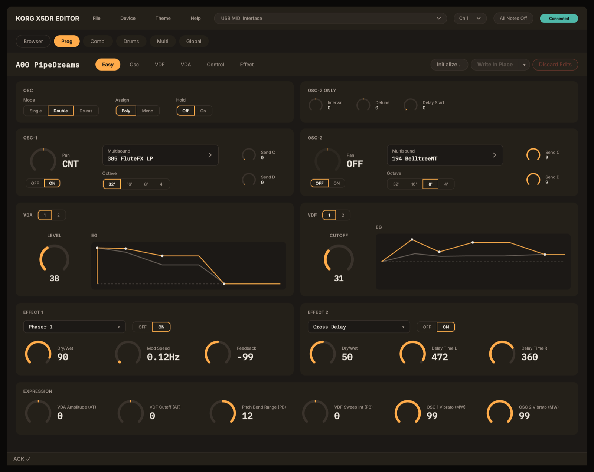
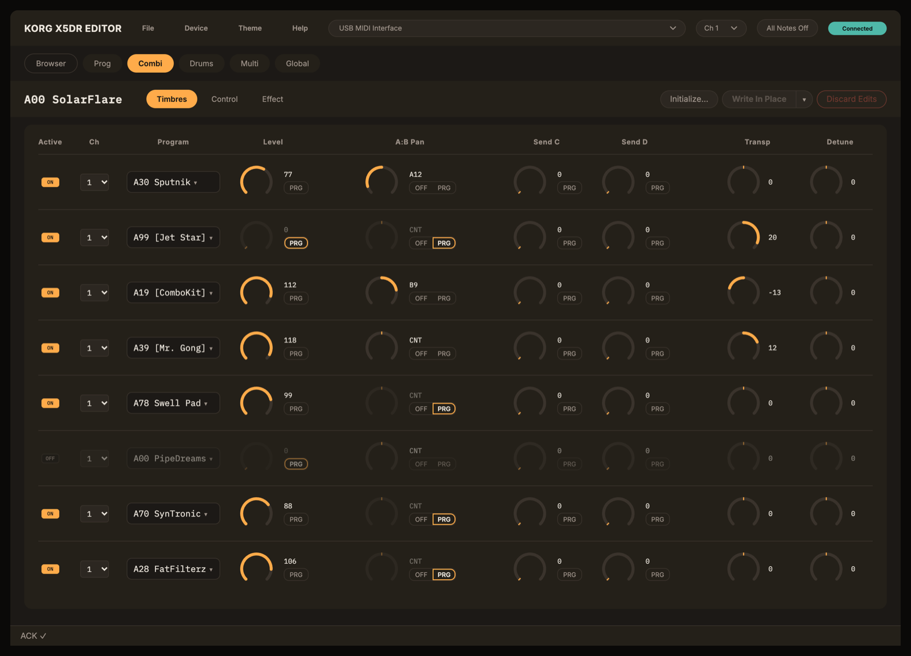

<p align="center">
  
</p>

# Korg X5DR Editor

A free, browser-based editor and librarian for the **Korg X5DR** synthesizer module. Edit every Program, Combination, Multi, Drum Kit and Global parameter in real time over MIDI, and load and save `.syx` files. There's nothing to install: open the website in Chrome or Edge.

**[Open the editor →](https://baylo1.github.io/x5dr-editor/)**





## Features

- Every **Program** parameter, on six pages (Easy, OSC, VDF, VDA, Control, Effect), with envelope displays and a Parametric EQ curve you can drag (hold Shift to change just one value). Edits are heard as you move a control.
- **Combinations**, **Multi**, **Global** and both **Drum Kits**, including which Programs and Combinations use each kit.
- All 47 **effect types**, with routing diagrams.
- **Write In Place** or **Write To A New Slot…**; **Discard Edits** reverts anything not yet written.
- Both **factory soundbanks** (A and B) built in, captured from a real X5DR. Bank B is the X5 and 05R/W factory set and works on every model; Bank A was made for the X5D and X5DR, and 45 of its 100 programs use X5D/X5DR-only sounds.
- **Initialize…** for Programs and Combinations: start from a clean patch.
- **File → Data File…** loads or saves exactly the parts you choose: Programs, Combinations, Multi, Drums, Global. Single Programs and Combinations too.
- **Device → Import From Device / Write to Device** for every data type.
- **All Notes Off** in the header stops stuck notes on every MIDI channel.
- Three colour themes.

## Requirements

- A **Chromium-based browser**, for Web MIDI with SysEx. **Chrome** and **Edge** have been verified on macOS and Windows, and **Brave** on Linux. Safari and Firefox are not supported. Reports of other browser and OS combinations are welcome.
- A **MIDI interface** connected both ways: computer out → X5DR MIDI In, and X5DR MIDI Out → computer in. Use a reputable interface; cheap unbranded USB-MIDI cables often fail on long SysEx transfers.

## Supported devices

| Model | Status |
|---|---|
| **X5DR** | Built and tested on hardware |
| X5D | Expected to work; untested |
| X5, 05R/W | Largely compatible (fewer multisounds and drums); untested |

**Own an X5, X5D or 05R/W?** Please file a [device report](https://github.com/Baylo1/x5dr-editor/issues/new/choose); that's how these models get verified.

## Setup

1. **Enable SysEx reception** on the device: [GLOBAL], page 02D, set **EX:** to **ENA**.
2. **Turn off write protection** to write Programs and Combinations: [GLOBAL], page 03A/03B (PROTECT), set PROGRAM and COMBINATION to **OFF**.
3. **Match the MIDI channel:** set the editor's **Ch** selector (top right) to the device's Global MIDI Channel ([GLOBAL], page 02A, CH; default 1). The device silently ignores SysEx on any other channel.
4. **Choose the port:** ports with "X5" in their name are selected automatically; otherwise pick your interface's output. Some MIDI drivers let only one program use a port at a time: if the port is missing or won't open, close your DAW and reload the editor.
5. **Allow MIDI** when the browser asks.

The editor sends no notes. To hear a sound, play it from a keyboard or a DAW, through the same MIDI interface. If a note gets stuck, click **All Notes Off** in the header.

## Ways to run it

| | How | Notes |
|---|---|---|
| **Website** | [baylo1.github.io/x5dr-editor](https://baylo1.github.io/x5dr-editor/) | Always the latest version; remembers your MIDI permission. |
| **Installed app** | On the website, click the install icon at the right of the address bar. | Opens in its own window from the Dock, Start menu or Spotlight. Needs an internet connection. |
| **Downloaded file** | Download `index.html` from [Releases](https://github.com/Baylo1/x5dr-editor/releases) and open it in a Chromium-based browser. | Works offline. Asks for MIDI permission every time it opens, and doesn't update itself. |

## Troubleshooting

In the editor, open **Help → Troubleshooting**. The usual causes are a channel mismatch, SysEx not enabled on the device, write protection, a port held by another program, or a cheap MIDI cable.

## Feedback

- **GitHub Issues** (preferred): [bug report, device report or feature request](https://github.com/Baylo1/x5dr-editor/issues/new/choose).
- **Email:** x5dr-editor-feedback@baylisconsulting.com, if you don't use GitHub. Reports may be copied into Issues, without your personal identifying details.

In the editor, **Help → Copy Diagnostics** copies your version, browser and MIDI setup for a report.

## License and notices

- The editor's code is released under the [MIT License](LICENSE).
- **Factory soundbanks** A and B are Korg's original factory sound data, captured from a real X5DR. They are not covered by the MIT License.
- The **MIDI implementation tables** in `docs/` are transcribed from the Korg X5DR Owner's Manual, © Korg Inc.
- **Typefaces:** Inter and IBM Plex Mono, under the SIL Open Font License 1.1 (`src/fonts/`).
- Not affiliated with or endorsed by Korg Inc. KORG is a registered trademark of Korg Inc.; model names are used only to identify compatible hardware.

## For developers

The app is plain HTML, CSS and JavaScript with no framework. `src/index.html` plus a few ES modules in `src/midi/`, `src/state/` and `src/ui/`; `npm run build` inlines them into one self-contained `dist/index.html`.

```bash
npm install          # dev tools only (Vitest)
npx vitest run       # unit tests for the MIDI/data layer
npm run build        # → dist/index.html
npx serve src        # run from source on http://localhost:3000
npm run screenshots  # regenerate docs/images/ (headless Chrome; set CHROME_PATH off macOS)
```

- Read **[CONTRIBUTING.md](CONTRIBUTING.md)** before opening a pull request.
- `CLAUDE.md` and `docs/` hold the design history: the Project Context, the **Landmines** (non-obvious facts that cause regressions if forgotten), the Decision Archive and the ADRs.
- The MIDI reference is in `docs/X5DR Manual Appendix - MIDI Implementation/`.
